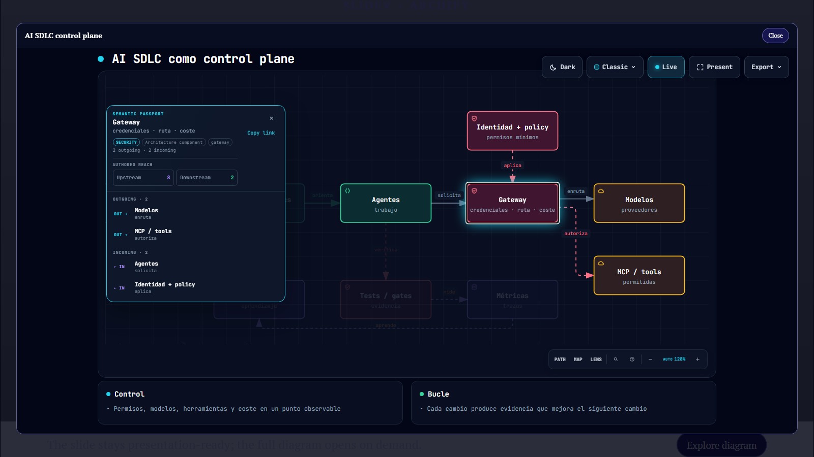

# Slidev Archify Explorer

**Make an Archify diagram a clickable, print-safe preview in Slidev.** Authors provide the static SVG and interactive HTML once; the preview itself opens the full Archify viewer in a dialog.

[Component site and live demo](https://svg153.github.io/slidev-archify-explorer/) · [Open the presentation](https://svg153.github.io/slidev-archify-explorer/demo/)

[](https://github.com/svg153/slidev-archify-explorer/actions/workflows/ci.yml)
[](https://www.npmjs.com/package/slidev-addon-archify-explorer)
[](https://github.com/svg153/slidev-archify-explorer/releases)
[](LICENSE)



## What it does

`ArchifyExplorer.vue` renders the static SVG as a clickable preview. Clicking anywhere on the preview opens a native dialog containing Archify's standalone HTML viewer, so viewers can focus nodes, follow relationships, search, and use the Archify controls without leaving the presentation.

- Works with Archify standalone HTML files; the HTML carries its viewer with it.
- Respects Slidev's configured base path.
- Uses a keyboard-operable native button and `<dialog>`, with an accessible preview, labelled dialog, and titled iframe.
- Keeps the static preview in Slidev PDF/print mode and omits the interactive controls.
- Supports a default preview prop and a slot for custom preview/layout content.
- Button and close labels can be localized.
- In presenter mode, mirrors this component's open, focused-node, and close state to the matching audience slide.

## Try the demo

```sh
npm ci
npm run dev
```

Slidev opens the one-slide example at `http://localhost:3030`. Click the diagram preview, then select a node in the Archify view.

The demo pairs `public/diagrams/ai-sdlc-control-plane.svg` (static slide/PDF image) with `public/diagrams/ai-sdlc-control-plane.html` (interactive viewer). Its editable Archify source is in `diagrams/`.

## Use it in your deck

Install the published package from npm:

```sh
npm install --save-dev slidev-addon-archify-explorer
```

Declare the addon in the deck frontmatter:

```yaml
addons:
  - slidev-addon-archify-explorer
```

Put the standalone Archify HTML and SVG under `public/`, then use one component:

Concurrent sessions using the same origin, base path, and deck title should pass a shared explicit `sync-session` value; the fallback scope is the current origin, base path, and deck title.

```md
<ArchifyExplorer
  preview="diagrams/system.svg"
  src="diagrams/system.html"
  title="System architecture"
  alt="System architecture diagram"
  button-label="Explore diagram"
  close-label="Close"
/>
```

`preview` and `src` are paths under `public/`, not remote URLs. Slidev's base URL is prepended automatically. Clicking anywhere on the SVG opens the explorer, and the preview uses a zoom cursor to communicate that behavior. The default labels are English; pass `button-label` and `close-label` to localize them.

Presenter mode syncs only the explorer state for the current slide. Messages are scoped to the same-origin deck title/base path and component; they never include presenter notes or slide content. If a slide contains multiple explorers with the same `src` and `title`, give each pair a distinct `sync-key`:

```md
<ArchifyExplorer
  preview="diagrams/system.svg"
  src="diagrams/system.html"
  title="System architecture"
  sync-key="system-overview"
  sync-session="room-a"
/>
```

The sync uses a narrowly named same-origin `BroadcastChannel`. Without `sync-session`, the fallback scope is the current origin, base path, and deck title; use the prop to separate concurrent rooms. It is additive: a normal standalone slide still opens and controls its own dialog, and print/PDF mode continues to render only the static preview.

For a custom preview or layout, provide slot content instead of `preview`; the slot is preserved in print mode:

```md
<ArchifyExplorer src="diagrams/system.html" title="System architecture">
  <div class="custom-preview">...</div>
</ArchifyExplorer>
```

## Commands

| Command | Description |
| --- | --- |
| `npm run dev` | Start the addon demo presentation |
| `npm run build` | Build the demo deck |
| `npm run build:pages` | Build the component site and hosted demo into `dist/` |
| `npm run export` | Export the demo deck to PDF |

Requires Node.js 22 or newer.

## Contributing

Issues and pull requests are welcome. Use [Conventional Commits](https://www.conventionalcommits.org/) for commit messages and PR titles, for example `feat: support custom button labels`. See [CONTRIBUTING.md](CONTRIBUTING.md), [SECURITY.md](SECURITY.md), and [CODE_OF_CONDUCT.md](CODE_OF_CONDUCT.md).

Release tags and GitHub releases are generated from Conventional Commits with [semantic-release](https://github.com/semantic-release/semantic-release). npm releases are published by GitHub Actions when npm Trusted Publishing is configured; see [npm release setup](docs/NPM_PUBLISHING.md) and the [release security notes](docs/RELEASE_SECURITY.md).

## License

The component and demo source are MIT-licensed; see [LICENSE](LICENSE). The included standalone diagram embeds Archify and third-party viewer code. See [THIRD_PARTY_NOTICES.md](THIRD_PARTY_NOTICES.md) and [ARCHIFY-LICENSE](ARCHIFY-LICENSE).
